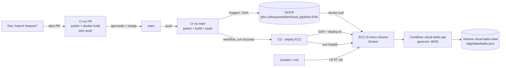

# Relatório — Esteira de CI/CD da Cloud Tasks API na AWS

**Disciplina:** Computação em Nuvem — Projeto Final
**Repositório:** https://github.com/brayanwisller/Cloud_Pipeline
**Pull Request:** https://github.com/brayanwisller/Cloud_Pipeline/pull/4
**Aplicação (enquanto ativa):** http://44.216.140.60/health

## 1. Integrantes e distribuição das tarefas

| Integrante | Responsabilidades |
|---|---|
| Brayan Wisller | Repositório, branches/PR, código da API (CRUD, `DELETE`, filtro), testes e workflows de CI/CD |
| Lucas Araújo | Aprovisionamento da EC2, Security Group, Elastic IP, Docker na instância, secrets do GitHub |
| Matheus de Tassi | Testes de persistência, coleta de evidências, relatório e controle de custos |

## 2. Arquitetura e fluxo



**Resumo do fluxo:** o desenvolvimento acontece em `feature/new-endpoints`. Ao abrir o PR, a CI roda `pytest` e um build Docker *sem publicar*. Após o merge na `main`, a CI repete os testes e publica a imagem no GHCR com a tag igual ao **SHA do commit** (imagem imutável). O sucesso dessa CI dispara o CD (`workflow_run`), que entra na EC2 por SSH, executa `scripts/deploy.sh` (pull da imagem do SHA, recria o contêiner com o volume) e valida `GET /health`.

## 3. Aplicação e evolução funcional

A API foi reescrita em Flask com persistência em arquivo JSON (`tasks.json`) dentro de `DATA_DIR`, com tipagem.

| Método | Rota | Função |
|---|---|---|
| GET | `/health` | Saúde da aplicação |
| POST | `/tasks` | Cria tarefa (`title`, `status`) → 201 |
| GET | `/tasks` | Lista tarefas; **melhoria:** filtro `?status=pendente\|concluido` |
| GET | `/tasks/<id>` | Busca uma tarefa → 200/404 |
| PUT | `/tasks/<id>` | Atualiza título/status → 200/404 |
| DELETE | `/tasks/<id>` | **Requisito:** exclui → 204, inexistente → 404 |

**Testes automatizados (6, todos passando):** `test_health_check`, `test_crud_flow`, `test_delete_task_success` (204), `test_delete_task_not_found` (404), `test_update_task_not_found` (extra) e `test_filter_tasks_by_status` (melhoria).

## 4. Infraestrutura e portas

| Recurso | Configuração |
|---|---|
| Região / AZ | us-east-1 (Norte da Virgínia) / us-east-1a |
| Instância | `cloud-tasks-api` — `i-03f4d59b7be3d2c01`, **t3.micro** |
| AMI | Ubuntu Server 26.04 (`ubuntu-resolute-26.04-amd64-server-20261016`) |
| Armazenamento | Volume EBS gp3 raiz |
| Par de chaves | `cloud-pipeline-key` |
| IP público | **Elastic IP 44.216.140.60** (substitui o IP dinâmico 18.208.217.222, que mudava a cada reinício) |
| Docker | `docker.io` instalado via `scripts/setup-ec2-ubuntu.sh`; usuário `ubuntu` no grupo `docker` |
| Registry | GHCR, pacote `cloud_pipeline` com visibilidade pública (pull sem credencial na EC2) |

**Security Group:**

| Tipo | Porta | Origem | Uso |
|---|---|---|---|
| HTTP | TCP 80 | 0.0.0.0/0 | Acesso à API e checagem `/health` pelo CD |
| SSH | TCP 22 | 191.176.130.79/32 | Administração e deploy |

**Mapeamento de portas:** host `80` → contêiner `8000` (gunicorn). O volume nomeado `cloud-tasks-data` é montado em `/app/data`.

**Segredos e variáveis (GitHub → Settings → Secrets and variables → Actions):** secrets `EC2_HOST`, `EC2_SSH_KEY`, `EC2_KNOWN_HOSTS`; variable `EC2_USER=ubuntu`; environment `production`. Nenhuma chave ou token foi versionado. O `EC2_KNOWN_HOSTS` foi gerado com `ssh-keyscan -H` executado **de dentro da própria instância**, garantindo que a fingerprint é a do host real.

## 5. Evidências

| Evidência | Link / status |
|---|---|
| PR com CI aprovada | https://github.com/brayanwisller/Cloud_Pipeline/pull/4 |
| Run de CD aprovado | https://github.com/brayanwisller/Cloud_Pipeline/actions/runs/43738021929/job/132934745983 |
| Imagem publicada por SHA | `ghcr.io/brayanwisller/cloud_pipeline:99cf9da8c68fded1cf4f7671b9d4d61fd9af98ad` — https://github.com/users/brayanwisller/packages/container/cloud_pipeline/1568694530?tag=99cf9da8c68fded1cf4f7671b9d4d61fd9af98ad |
| Health check | `curl http://44.216.140.60/health` → `{"status":"ok"}` |

### Prova de persistência

Roteiro executado na EC2 / pela máquina local:

```bash
# 1. Criar uma tarefa
curl -X POST http://44.216.140.60/tasks -H 'Content-Type: application/json' \
     -d '{"title":"Teste de persistência","status":"pendente"}'

# 2. Listar (deve aparecer a tarefa)
curl http://44.216.140.60/tasks

# 3. Na EC2: destruir e recriar o contêiner (mesmo volume)
docker rm -f cloud-tasks-api
docker run -d --name cloud-tasks-api --restart unless-stopped \
  -p 80:8000 -v cloud-tasks-data:/app/data -e DATA_DIR=/app/data \
  ghcr.io/brayanwisller/cloud_pipeline:99cf9da8c68fded1cf4f7671b9d4d61fd9af98ad

# 4. Listar novamente — a tarefa continua lá
curl http://44.216.140.60/tasks
```

## 6. Dificuldades encontradas e soluções

1. **`PermissionError: '/app'` na CI.** O código criava o diretório de dados em `/app/data` fixo; no runner do GitHub não há permissão na raiz. **Solução:** o caminho passou a vir de `DATA_DIR` com padrão relativo `data`; no Dockerfile e no `deploy.sh` define-se `DATA_DIR=/app/data`.
2. **Comando do pytest na CI.** O passo de testes falhava por instalação/execução incorreta; corrigido para instalar `requirements-dev.txt` e rodar `python -m pytest -q`.
3. **Primeiro CD falhou.** O workflow de CD rodou antes de a infraestrutura e os secrets estarem completos (host, chave e known_hosts). Foi necessário configurar os secrets e o environment `production`.
4. **IP público mudando.** Ao reiniciar a EC2 o IP mudava (18.208.217.222), invalidando `EC2_HOST` e `EC2_KNOWN_HOSTS`. **Solução:** alocar um Elastic IP (44.216.140.60). Atenção: o `EC2_HOST` e a entrada do `known_hosts` precisam usar o **mesmo** nome/IP; com o Elastic IP, o `ssh-keyscan` deve ser refeito para `44.216.140.60`.
5. **SSH a partir do runner hospedado.** Os runners do GitHub não têm IP fixo, e o enunciado proíbe `0.0.0.0/0` na porta 22.
6. **Conexão SSH caindo** (`client_loop: send disconnect: Connection reset`) durante o uso do terminal, resolvida reconectando.

## 7. Custos e recursos

A conta usada é do **AWS Academy (Learner Lab)**, com créditos; não houve cobrança em cartão. Estimativa de referência em us-east-1 (sob demanda, sujeita a alteração):

| Recurso | Preço de referência | Observação |
|---|---|---|
| EC2 t3.micro | ≈ US$ 0,0104/h (≈ US$ 7,50/mês 24×7) | Crédito "unlimited" pode gerar custo extra se exceder a linha de base de CPU |
| EBS gp3 8 GB | ≈ US$ 0,08/GB-mês (≈ US$ 0,64/mês) | Cobrado mesmo com a instância parada |
| IPv4 público / Elastic IP | ≈ US$ 0,005/h (≈ US$ 3,60/mês) | Cobrado associado ou não; liberar ao final |
| GHCR / GitHub Actions | Gratuito | Repositório com minutos inclusos; pacote público |

**Custo real registrado (AWS Billing / Cost Explorer, Learner Lab):**

| Serviço | Integrante A | Integrante B | Total |
|---|---:|---:|---:|
| Amazon EC2 — Compute (horas da t3.micro) | US$ 0,08 | US$ 0,08 | US$ 0,16 |
| EC2 — Other (volume EBS) | US$ 0,06 | US$ 0,06 | US$ 0,12 |
| Amazon VPC (IPv4 público / Elastic IP) | US$ 0,04 | US$ 0,04 | US$ 0,08 |
| Amazon CloudWatch | US$ 0,00 | US$ 0,00 | US$ 0,00 |
| Outros | US$ 0,00 | US$ 0,00 | US$ 0,00 |
| **Total** | **US$ 0,18** | **US$ 0,18** | **US$ 0,36** |

O gasto total do grupo foi de **US$ 0,36**, debitado dos créditos do Learner Lab. O maior custo veio das horas de execução da instância. Os custos de EBS e IP aparecem mesmo com a instância parada.


## 8. Limitações

Deploy didático: sem TLS, balanceador, alta disponibilidade ou rollback automático. A persistência em JSON não suporta escrita concorrente segura entre vários workers/instâncias. Não usar dados reais.

## 9. Vídeo de demonstração

Vídeo com o passo a passo da execução do trabalho (PR, CI/CD no GitHub Actions, deploy na EC2 e API funcionando):

**[▶ Assistir no Google Drive](https://drive.google.com/file/d/1Q89eYcbtiRde0mon6TxN1ZQ94WGQL-7J/view?usp=sharing)**
